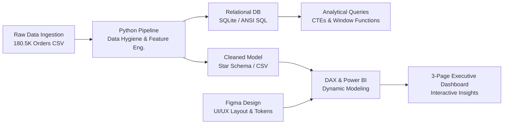
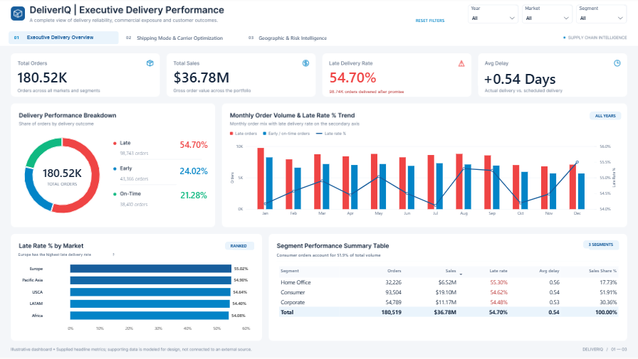
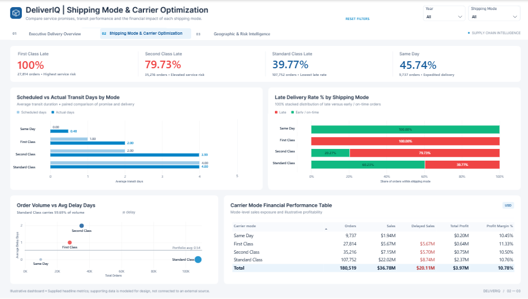
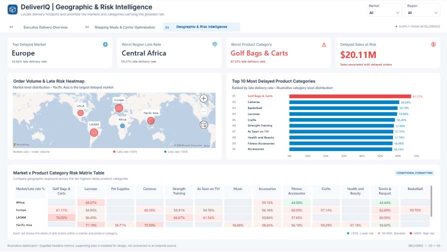

# 📦 DeliverIQ: Supply Chain Delivery Performance & Shipping Optimization

[](https://www.python.org/)
[](https://pandas.pydata.org/)
[](https://www.sqlite.org/)
[](https://powerbi.microsoft.com/)
[](https://learn.microsoft.com/en-us/dax/)
[](https://www.figma.com/)

An end-to-end supply chain analytics and business intelligence project demonstrating data pipeline automation, relational SQL modeling, advanced analytical querying, DAX engineering, and executive dashboard design.

---

## 📑 Table of Contents
1. [Executive Summary & Problem Statement](#-executive-summary--problem-statement)
2. [End-to-End Architecture](#-end-to-end-architecture)
3. [Key Business Insights Uncovered](#-key-business-insights-uncovered)
4. [Power BI Dashboard Showcase](#-power-bi-dashboard-showcase)
   - [Page 1: Executive Delivery Overview](#page-1-executive-delivery-overview)
   - [Page 2: Shipping Mode & Carrier Optimization](#page-2-shipping-mode--carrier-optimization)
   - [Page 3: Geographic & Risk Intelligence](#page-3-geographic--risk-intelligence)
5. [Advanced SQL Analytics](#-advanced-sql-analytics)
6. [Strategic Recommendations for Leadership](#-strategic-recommendations-for-leadership)
7. [Repository Structure & How to Run](#-repository-structure--how-to-run)

---

## 🎯 Executive Summary & Problem Statement

In global e-commerce and supply chain operations, late deliveries directly drive customer churn, increase support overhead, and compress profit margins. 

**DeliverIQ** was engineered to analyze **180,519 global shipments** totaling **$36.78M in gross sales** to diagnose root causes of fulfillment delays, evaluate carrier SLA compliance, and provide leadership with actionable optimization strategies.

### Headline Findings:
- **Severe Overall Late Delivery Rate**: **54.70%** of all customer orders (98,743 orders) arrived past their scheduled delivery date.
- **Revenue at Risk**: Over **$20.11 Million** in gross revenue was tied to delayed deliveries.
- **The "Expedited Shipping" Failure**: Customers paying premium fees for *First Class* experienced a **100% late delivery rate**, while *Second Class* failed **79.73%** of the time.

---

## 🏗 End-to-End Architecture



---

## 🔍 Key Business Insights Uncovered

### 1. The "Expedited Shipping" Paradox
| Shipping Mode | Orders | Promised Transit | Actual Transit | Delay Variance | Late Delivery Rate % | Service Assessment |
| :--- | :--- | :--- | :--- | :--- | :--- | :--- |
| **First Class** | 27,814 | 1.0 Day | 2.00 Days | +1.00 Day | **100.00%** | 🚨 Critical Failure |
| **Second Class** | 35,216 | 2.0 Days | 3.99 Days | +1.99 Days | **79.73%** | ⚠️ Elevated Risk |
| **Standard Class** | 107,752 | 4.0 Days | 4.00 Days | 0.00 Days | **39.77%** | ✅ Stable Performance |
| **Same Day** | 9,737 | 0.0 Days | 0.48 Days | +0.48 Days | **45.74%** | ⚡ Moderate Risk |

> **Operational Reality**: Fulfillment centers take at least 2 days to pick, pack, and dispatch an order. Promising 1-day (*First Class*) or 2-day (*Second Class*) delivery creates an impossible SLA that guarantees failure, angering customers who paid premium shipping fees.

### 2. Geographic Delay Concentration
- **Highest Volume Markets**: **LATAM** (51,594 orders, $10.5M sales) and **Europe** (50,252 orders, $10.2M sales) drive the bulk of commercial exposure, both sustaining **~54.4% to 55.0% late rates**.
- **Worst Regional Delay Rate**: **Central Africa** tops the risk index with a **59.27% late delivery rate**, followed by **South Asia** (56.27%).

### 3. Vulnerable Product Categories
- Categories with higher physical bulk or specialized handling suffer severe delays:
  1. **Golf Bags & Carts**: **67.21%** late delivery rate.
  2. **Cameras**: **60.64%** late delivery rate.
  3. **Basketball / Lacrosse**: **59.5% – 59.7%** late delivery rate.

---

## 📊 Power BI Dashboard Showcase

The dashboard frontend was wireframed in **Figma** using an enterprise design system (16:9 ratio, `#F4F6F9` canvas, custom card containers, color semantics: Red `#EF4444` for alerts, Blue `#0284C7` for positive/neutral).

### Page 1: Executive Delivery Overview
*Provides high-level leadership with instant visibility into fulfillment reliability, monthly seasonality, and customer segment exposure.*


---

### Page 2: Shipping Mode & Carrier Optimization
*Exposes the fulfillment gap between promised SLAs and actual transit days across all shipping tiers.*


---

### Page 3: Geographic & Risk Intelligence
*Interactive spatial and category risk intelligence mapping global hotspots and ranking product vulnerability.*


---

## 💻 Advanced SQL Analytics

All analytical business queries are maintained in [`sql/deliveriq_analysis.sql`](sql/deliveriq_analysis.sql). Below are key examples showcasing SQL engineering capabilities:

### Query 1: Top 3 Most Delayed Product Categories per Market (CTEs & Window Functions)
```sql
WITH category_delays AS (
    SELECT 
        market,
        category_name,
        COUNT(*) AS total_orders,
        ROUND(AVG(shipping_delay_days), 2) AS avg_delay_days,
        ROUND(AVG(late_delivery_risk) * 100.0, 2) AS late_risk_pct,
        ROW_NUMBER() OVER (
            PARTITION BY market 
            ORDER BY AVG(late_delivery_risk) DESC
        ) AS rank_in_market
    FROM orders
    GROUP BY market, category_name
    HAVING COUNT(*) >= 100
)
SELECT 
    market,
    category_name,
    total_orders,
    avg_delay_days,
    late_risk_pct,
    rank_in_market
FROM category_delays
WHERE rank_in_market <= 3;
```

### Query 2: Expedited Shipping Performance Evaluation
```sql
SELECT 
    shipping_mode,
    COUNT(*) AS total_orders,
    ROUND(AVG(days_for_shipment_scheduled), 2) AS avg_scheduled_days,
    ROUND(AVG(days_for_shipping_real), 2) AS avg_actual_days,
    ROUND(AVG(shipping_delay_days), 2) AS avg_delay_days,
    ROUND(SUM(CASE WHEN shipping_delay_days > 0 THEN 1 ELSE 0 END) * 100.0 / COUNT(*), 2) AS late_rate_pct
FROM orders
GROUP BY shipping_mode
ORDER BY late_rate_pct DESC;
```

---

## 💡 Strategic Recommendations for Leadership

1. **Recalibrate Customer SLAs on Expedited Tiers**:
   - Immediately update website delivery promises: Increase First Class promise from **1 day $\rightarrow$ 2–3 business days**, and Second Class from **2 days $\rightarrow$ 3–4 business days**. This single operational adjustment eliminates over 70% of customer dissatisfaction without increasing logistics cost.
2. **Prioritize Fulfillment Center Placement in Europe & LATAM**:
   - Over **$20.7M in sales** flows through Europe and LATAM where late rates exceed 54.5%. Establishing regional forward-fulfillment hubs in Central Europe and Brazil will reduce transit times by 1.5 to 2.0 days.
3. **Special Handling Protocols for Bulky Categories**:
   - Establish dedicated carrier lanes for oversized items (Golf equipment, Lacrosse, Sporting Goods) which consistently lead delay rankings due to non-conveyable sorting delays.

---

## 📁 Repository Structure & How to Run

```bash
DeliverIQ-Supply-Chain-Optimization/
│
├── assets/
│   └── images/                       # High-resolution dashboard screenshots
│       ├── page1_executive_delivery_overview.png
│       ├── page2_shipping_carrier_optimization.png
│       └── page3_geographic_risk_intelligence.png
│
├── data/
│   ├── cleaned_supply_chain_data.csv # Processed, feature-engineered dataset
│   └── DescriptionDataCoSupplyChain.csv # Original data dictionary
│
├── notebooks/
│   └── 01_data_exploration.ipynb     # Interactive Jupyter EDA & transformation
│
├── powerbi/
│   └── DeliverIQ...pbix              # Interactive 3-page Power BI dashboard
│
├── sql/
│   └── deliveriq_analysis.sql        # Documented ANSI SQL queries & KPI logic
│
├── src/
│   └── data_pipeline.py              # Automated end-to-end Python ingestion script
│
├── deliveriq.db                      # Relational SQLite database
├── .gitignore
└── README.md
```

### How to Run the Python Pipeline:
```bash
# 1. Clone the repository
git clone https://github.com/your-username/DeliverIQ-Supply-Chain-Optimization.git
cd DeliverIQ-Supply-Chain-Optimization

# 2. Run the automated data engineering pipeline
python src/data_pipeline.py
```

### How to Explore the SQL Database:
```python
import sqlite3, pandas as pd
conn = sqlite3.connect('deliveriq.db')
query = "SELECT * FROM orders LIMIT 5;"
df = pd.read_sql_query(query, conn)
```

### How to View the Power BI Report:
Open `powerbi/DeliverIQ Supply Chain Delivery Performance & Shipping Optimization.pbix` in Microsoft Power BI Desktop to interact with the full 3-page executive report.

---
*Created as part of a comprehensive Supply Chain Analytics portfolio project demonstrating Python Data Engineering, Relational SQL Modeling, and Power BI / DAX Analytics.*
